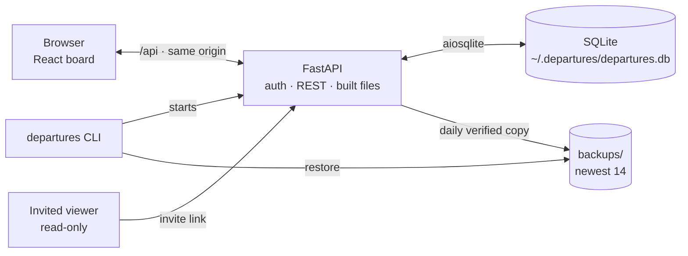

<picture>
  <source media="(prefers-color-scheme: dark)" srcset="assets/logo-dark.svg">
  
</picture>

**A project manager that looks like a train station split-flap departure board.** One command, the browser opens, and your projects flip in. You glance up and know where everything stands.

It is local-first: one SQLite file on your machine, daily verified backups, no accounts, no cloud. It is built for one person juggling too many projects, especially with ADHD — so it has opinions about what to work on instead of showing you a list.

**Start here:** install the wheel, run `departures`, read **The board**. Everything else can wait.

**How to read this:** two minutes down to **Your data**. Internals, the data model and the design rules live in [`docs/ARCHITECTURE.md`](docs/ARCHITECTURE.md).


---

## What you get

- **A board, not a list.** Every project is a split-flap card with a status, a next action, a track and a mile marker.
- **TODAY** puts today's time-blocked projects, dated events and a NOW line on one timeline.
- **NEXT UP** scores your projects and marks the one to do next with amber.
- **Flip notes.** Turn any card over for a scratchpad that saves as you type.
- **Your data is safe.** Daily verified backups, a guided `restore`, and archive instead of delete with undo.
- **Read-only sharing.** Send an invite link to someone on your Wi-Fi; they can look, not touch.

---

## Install

### Fastest: the wheel

Download the `.whl` from [Releases](https://github.com/JosephOIbrahim/Slit-Flap/releases), then:

```bash
pip install departures-0.5.6-py3-none-any.whl
departures
```

No Node, no build step. The wheel bundles the built board.

### From source

Prefer a clone? The prerequisites and the four build commands are in [`docs/USING.md`](docs/USING.md#build-from-a-clone). The short version: `pip install -e .`, then `cd frontend && npm install && npm run build`, then `departures`.

---

## The board

### TODAY

Today is a timeline, not a list: time-blocked projects, events dated today, and a **NOW** line showing where you are. A project with no block waits below under **No time blocked**.

Set a block from the card's **TIME TODAY** field. It is stamped with today's date, so yesterday's block does not follow you into today; an old block shows its date and a CLEAR button instead of vanishing.

### Cards, notes and status

Each card carries its track, domain, next action and mile marker. Click it to open the edit panel; click **↻** to flip it over to its notes.

Notes auto-save after a second of stillness. They only become editable once the stored note has loaded, so an empty editor can never overwrite a real note; a failed load offers **NOTES UNAVAILABLE · RETRY**. Pending edits flush when the tab hides or closes, and paste is plain text.

A deadline turns into board language: **DEPARTS 3D**, **DEPARTS TODAY**, **DELAYED 2D**.

If a save cannot reach the board, one amber dot appears in the header and the board keeps retrying; keep the tab open until it clears.

### NEXT UP

The board scores active work and puts an amber border on the winner:

| Signal | Points |
|--------|--------|
| Time blocked today | +100 |
| ACTIVE | +50 |
| REVIEW (finished, waiting on you) | +45 |
| ROLLING | +40 |
| BLOCKED | +5 |
| Track 01 / 02 / 03 | +30 / +20 / +10 |
| Each day untouched | +3, up to +40 |
| Deadline passed or close | up to +35 |

QUEUED and SHIPPED cards never score. You can override the order with ▲ ▼, but the board has an opinion so you do not have to decide.

### Pulse and recap

A small dot in the header measures the current work session, not server uptime. A session starts on your first interaction after a 45-minute gap.

| Dot | Meaning |
|-----|---------|
| Green | Under 2 hours |
| Amber | 2–4 hours; consider a break |
| Red | 4+ hours; walk away |

**REC** shows what you touched today, how many log entries you wrote, and how long you worked. `departures recap` prints the same in the terminal, on your local day rather than UTC.

### Filters and controls

`ALL`, `TODAY`, `ACTIVE`, `ROLLING`, `BLOCKED`, `REVIEW`, `QUEUED`, `SHIPPED`, `ARCHIVED`.

**S M L** changes character size. **◁ · ▷** aligns names. **▲ ▼** reorders within the list you are looking at; in TODAY the timeline stays ordered by time. **ZIP** adds local weather.

---

## Your data

Everything lives in one folder: `~/.departures/` (or wherever `DEPARTURES_HOME` points).

```
~/.departures/
├── departures.db     the board
├── backups/          verified daily copies, newest 14
└── launcher.log      silent launcher errors
```

**Backups happen on their own.** Once a day, the first time the board starts or is used, it saves a verified copy unless nothing has changed since the newest one. The 14 kept are 14 different versions of the board, however long it sat untouched. A failed backup shows **BACKUP FAILED** in the header, retries every 30 minutes, and never stops the board. If the PC clock is behind the newest backup, the board says **PC CLOCK IS BEHIND** and keeps copies separately instead of pruning.

### Restore a backup

**Restoring a backup.** Stop the board first. If it has no window (for example started from `departures-launch.vbs`), find the one using port 4040: `netstat -ano | findstr :4040` shows its PID on the `LISTENING` line, then `taskkill /PID <pid> /F`. Leave other Python programs alone.

```bash
departures restore                            # list the backups, newest first
departures restore departures-2026-11-10.db   # put one back
```

It checks the backup is a healthy board, shows what is on the board now and what is in the backup, warns if it would bring back viewer links you removed since, and asks before changing anything. The current board is kept as `departures-<date>-<time>-before-restore.db`, so a restore can be undone by restoring that file. An interrupted restore leaves either the old board or the restored one, never a mix.

**If the command cannot run**, the manual steps (including the `-wal` warning) are in [`docs/USING.md`](docs/USING.md).

### Archive, not delete

**ARCHIVE** and **−** hide a card instead of destroying it. Its notes and log stay attached. A toast offers **UNDO** for five seconds; afterwards the card waits in the **ARCHIVED** filter, where **RESTORE** brings it back.

---

## Sharing your board

Sharing is opt-in and read-only. Start with network access:

```bash
departures --host 0.0.0.0
```

The terminal prints your LAN address. In the board, click **SHR**, enter the viewer's email, **INVITE**, then **COPY LINK** and send it. They must be on the same network. The link sets a 30-day cookie; they see the board with a **VIEWING · READ ONLY** banner and cannot change anything. Only you can see or revoke viewer links.

If Windows Firewall asks, allow Python. The rule to add, and the windowless-launcher notes, are in [`docs/USING.md`](docs/USING.md).

---

## Commands

| Command | What it does |
|---------|--------------|
| `departures` | Start the board and open `http://localhost:4040` |
| `departures --port 9000` | Use another port |
| `departures --host 0.0.0.0` | Allow read-only sharing on your network |
| `departures --no-browser` | Start without opening a browser |
| `departures seed` | Replace the board with the 16 demo projects (asks first, backs up first) |
| `departures restore` | List backups, newest first |
| `departures restore <backup>` | Put a backup back (stop the board first; asks first) |
| `departures recap` | Print today's recap in the terminal |
| `departures --version` | Print the installed version |

Running `departures` while the board is already up just opens it in the browser.

Set `DEPARTURES_HOME` to keep the data somewhere else — a second board, a synced folder, a test.

---

## How it fits together



The server binds `127.0.0.1` by default. `--host 0.0.0.0` is the only way to share it, and only invited viewers get past the door.

Schema changes are ordered migrations tracked in `PRAGMA user_version`; an earlier 0.5.x board upgrades in place on first start, after that day's backup.

## Architecture and design

The board is a browser talking to one local FastAPI process, which owns one SQLite file and its backups. The design is studio-restraint: two typographic voices, one amber accent, whitespace as structure, motion only when something changed.

The system diagram above is the whole shape. The data model, the backup and restore lifecycle, the migration rules and the design details are in [`docs/ARCHITECTURE.md`](docs/ARCHITECTURE.md).

```bash
python -m pytest -q        # 143 backend tests
cd frontend && npm test    # 9 browser-side tests
cd frontend && npm run build
```

---

## Roadmap

- [x] Flip notes
- [x] Daily verified backups, guided restore, archive with undo
- [x] Dated time blocks and events
- [ ] Google Calendar and Gmail (replace the demo timeline)
- [ ] USD composition layer for project state
- [ ] PWA support
- [ ] Cloud deployment option

---

## License

MIT

---

*USD-Composed Project State · Solari Protocol v0.5.6*
