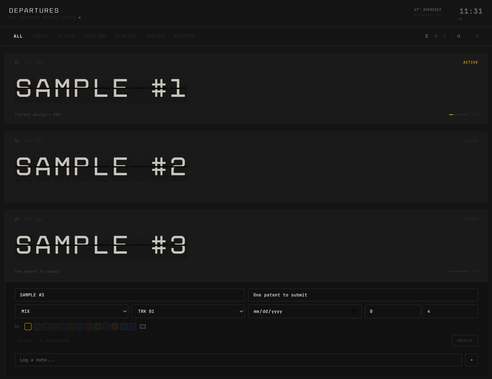
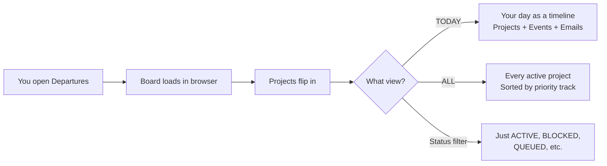
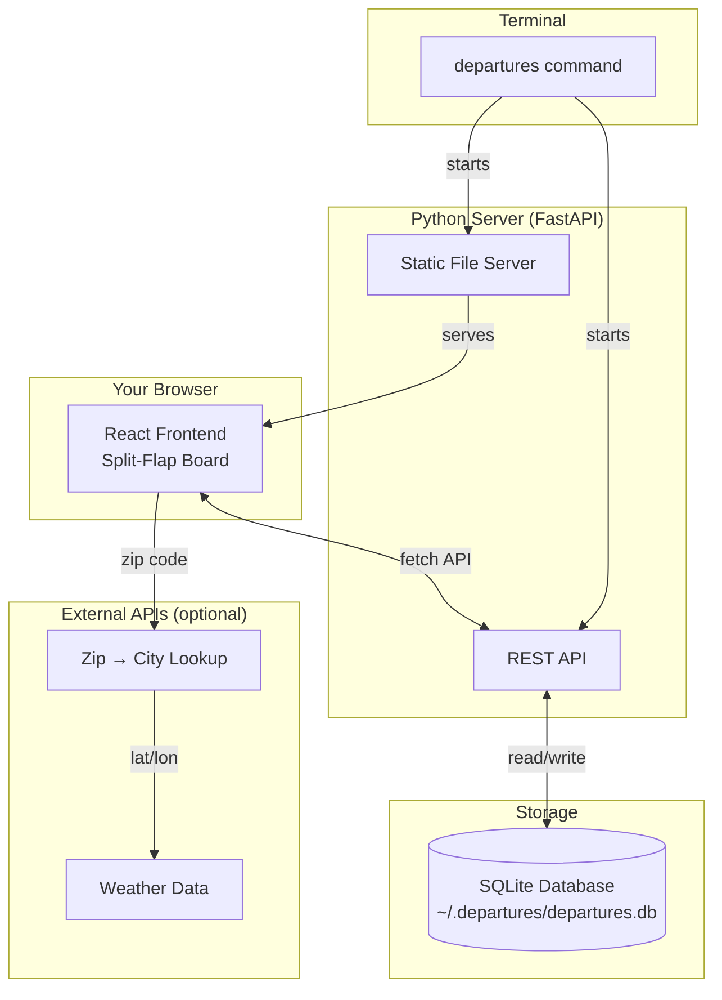
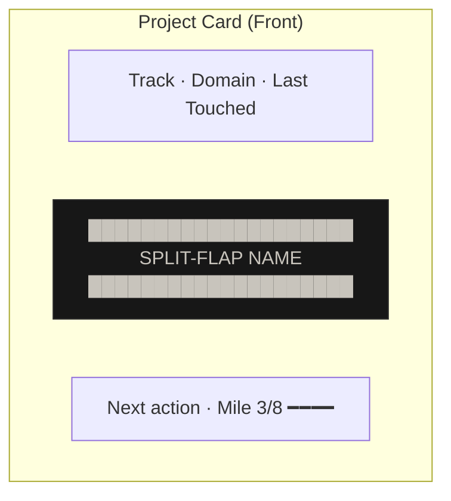
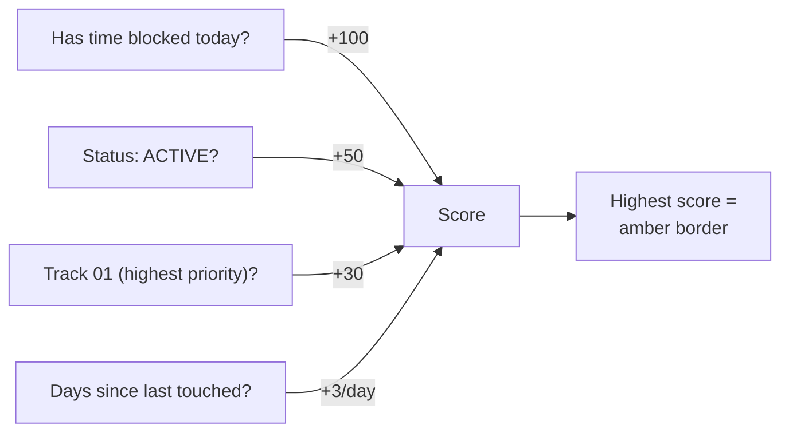
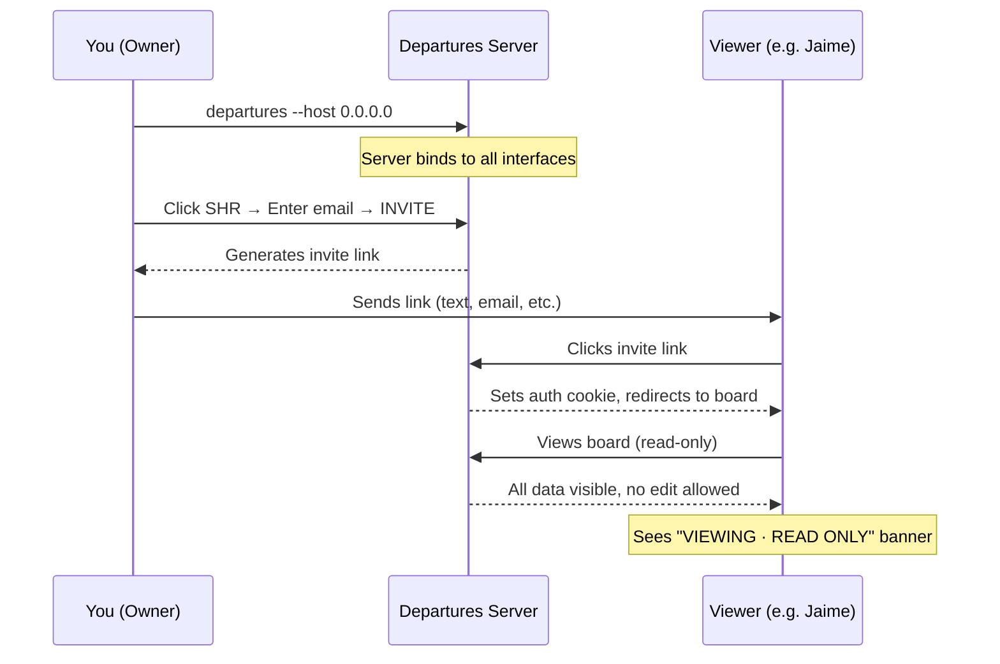
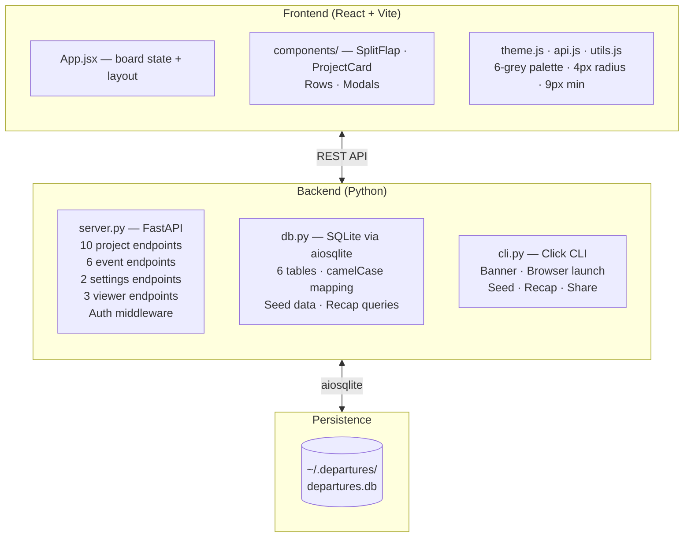
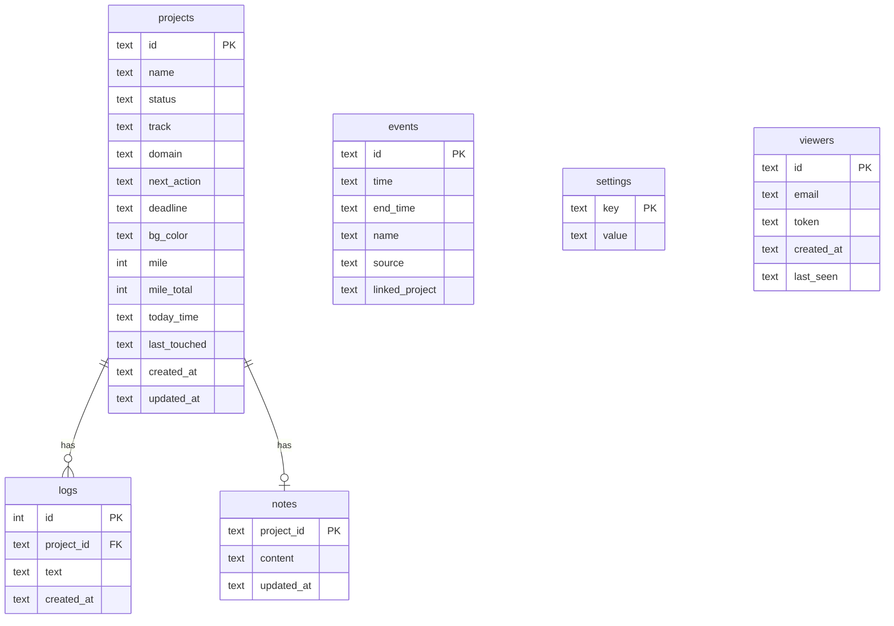

# DEPARTURES

```
  ╔═══╗ ╔═══╗ ╔═══╗ ╔═══╗ ╔═══╗ ╔═══╗ ╔═══╗ ╔═══╗ ╔═══╗ ╔═══╗
  ║ D ║ ║ E ║ ║ P ║ ║ A ║ ║ R ║ ║ T ║ ║ U ║ ║ R ║ ║ E ║ ║ S ║
  ╚═══╝ ╚═══╝ ╚═══╝ ╚═══╝ ╚═══╝ ╚═══╝ ╚═══╝ ╚═══╝ ╚═══╝ ╚═══╝
```

**A project manager that looks and feels like a train station split-flap departure board.**

One command. Browser opens. Your projects flip in like arrivals at Penn Station. You glance up and know where everything stands.



---

## What Is This? (Plain English)

Imagine the departure board at a train station — the one with physical letters that flip into place. Now imagine each row is one of your projects. The board tells you what's active, what's next, what shipped. It has opinions about what you should work on. It notices when you've been going too long.

That's Departures.

It's a project manager built for **creative directors, artists, and anyone juggling too many projects at once** — especially if you have ADHD and traditional project managers feel like staring at a spreadsheet.



**It is not** a Jira replacement. It is not a Notion database. It is a war room for one person (or a small team) who needs to see the whole battlefield at a glance.

---

## Install (Step by Step)

You need two things installed: **Python** (the programming language) and **Node.js** (for building the interface). If you're on Windows, Mac, or Linux, here's the full walkthrough.

### Prerequisites

| Tool | Version | How to check | How to install |
|------|---------|-------------|----------------|
| Python | 3.11 or newer | `python --version` | [python.org/downloads](https://www.python.org/downloads/) |
| Node.js | 18 or newer | `node --version` | [nodejs.org](https://nodejs.org/) |
| Git | any | `git --version` | [git-scm.com](https://git-scm.com/) |

### Setup (3 minutes)

Open a terminal (PowerShell on Windows, Terminal on Mac) and run these commands one at a time:

```bash
# 1. Download the project
git clone https://github.com/JosephOIbrahim/Slit-Flap.git
cd Slit-Flap

# 2. Install the Python backend
pip install -e .

# 3. Build the frontend (one time only — it builds straight into the app)
cd frontend
npm install
npm run build
cd ..

# 4. Launch
departures
```

Your browser opens. The board loads. You're working.

### After First Install

From now on, you only need one command:

```bash
departures
```

---

## How It Works



**Everything runs on your machine.** No cloud. No accounts. No subscriptions. Your data lives in a single file at `~/.departures/departures.db`.

**Backups happen on their own.** The first time the board starts or is used each day, a copy goes to `~/.departures/backups/departures-YYYY-MM-DD.db`. The newest 14 are kept. A day when nothing on the board changed gets no copy, so the 14 are always 14 different versions of your board, however long it sat untouched.

**Restoring a backup.** Stop the board (Ctrl+C in its window; if it runs with no window, for example started from `departures-launch.vbs`, end Python in Task Manager), then:

```bash
departures restore                            # list the backups, newest first
departures restore departures-2026-11-10.db   # put one back
```

It checks the backup is a healthy board, shows what's on the board now and what's in the backup, warns you if it would bring back viewer links you've removed since, and asks before changing anything. Your current board is kept in the backups folder (`departures-<date>-<time>-before-restore.db`), so a restore can be undone by restoring that file.

**Restoring by hand** (if you can't run the command):

1. Stop the board, as above.
2. Open the data folder: `~/.departures` on Mac and Linux. On Windows, paste `%USERPROFILE%\.departures` into File Explorer's address bar, and turn on View → Show → File name extensions so you can see which file is which.
3. Make a folder in it called `before-restore`, and move `departures.db` into that folder together with `departures.db-wal` and `departures.db-shm` if they're there. Keep the three together: the `-wal` file can hold your latest changes, so together they're a complete copy of the board you're replacing.
4. Copy the backup you want from the `backups` folder into the data folder and rename the copy to `departures.db`. On Windows, check it didn't become `departures.db.db`.
5. Start the board.

Don't leave `departures.db-wal` or `departures.db-shm` behind in step 3: they belong to the old board, and SQLite would replay them onto the restored one and corrupt it.

---

## Features

### The Board

Every project is a **split-flap card** — physical character modules with a horizontal split line through the letterforms, just like a real Solari departure board. Names flip into place with a mechanical animation when things change.

### Flip Notes

Every card has a back. Tap the **↻** icon in a card's top line and the whole card does a 3D flip — revealing a sticky-note surface for that project. Type freely (Ctrl+B bold, Ctrl+I italic), it auto-saves after a second of stillness, and **↩ BOARD** flips you back. Like turning over an actual departure card to find a note taped to the back.

### Departure Status

Set a deadline on a project and the board speaks train: **DEPARTS 3D** in amber as the date approaches (7 days out), **DEPARTS TODAY** on the day, and **DELAYED 2D** in red when it slips past. Delayed projects also climb the NEXT UP scoring — the board nags by reordering, not by notifications.



### TODAY View

Your day as a departure board. Projects with time blocked, calendar events, and emails — all sorted chronologically with a **NOW line** showing where you are in the day.

```mermaid
gantt
    title TODAY Timeline
    dateFormat HH:mm
    axisFormat %H:%M
    
    section Events
    Morning standup         :ev1, 09:00, 30m
    Client review call      :ev2, 11:30, 30m
    Design critique session :ev3, 15:00, 30m
    
    section Projects
    Brand Refresh (ACTIVE)  :active, 10:00, 60m
    This App (ACTIVE)       :active, 11:00, 60m
    Product Launch (ACTIVE) :crit, 14:00, 60m
    AR Prototype (ACTIVE)   :active, 16:00, 60m
```



### NEXT UP

The board picks your most urgent project based on:



You can override it. But it has an opinion so you don't have to decide.

### Display Controls

| Control | What it does | Where |
|---------|-------------|-------|
| **S M L** | Change split-flap character size (64 / 104 / 140px) | Filter bar, right side |
| **◁ · ▷** | Align project names left / center / right | Filter bar, right side |
| **▲ ▼** | Move a project up/down in priority | Bottom-right buttons (select a project first) |
| **ZIP** | Enter zip code for local weather in header | Top-right |

### Session Pulse

A small dot in the header. It doesn't nag. It's just there.

| Color | Meaning |
|-------|---------|
| Green | Under 2 hours. You're fresh. |
| Amber | 2-4 hours. Might want a break. |
| Red | 4+ hours. Walk away. Touch grass. |

### Daily Recap

Tap the **REC** button. See what you touched today, what shipped, how long you worked. Evidence of progress for the days when it doesn't feel like you did anything.

---

## Sharing Your Board

You can invite people to **view** your board in read-only mode. They see everything. They can't change anything.



### How To Share

```bash
# 1. Start with network access enabled
departures --host 0.0.0.0

# Terminal will show your LAN IP:
#   → Share: http://192.168.1.100:4040
```

2. In the browser, click the **SHR** button (bottom-right)
3. Enter the viewer's email → click **INVITE**
4. Click **COPY LINK** next to their name
5. Send the link to them

They need to be on the same Wi-Fi network. The link sets a cookie that lasts 30 days.

**Windows Firewall:** You may need to allow Python through the firewall when prompted. Or run:
```
netsh advfirewall firewall add rule name="Departures" dir=in action=allow protocol=TCP localport=4040
```

---

## Commands

| Command | What it does |
|---------|-------------|
| `departures` | Start the board (opens browser on localhost:4040) |
| `departures --port 9000` | Use a custom port |
| `departures --host 0.0.0.0` | Enable network access for sharing |
| `departures --no-browser` | Start without opening browser |
| `departures seed` | Replace the board with the 16 demo projects (asks first, saves a backup to `~/.departures/backups/`) |
| `departures restore` | List the backups, newest first |
| `departures restore <backup>` | Put a backup back (stop the board first; asks first; keeps the current board as a backup) |
| `departures recap` | Print today's recap in the terminal |
| `departures --version` | Print the installed version |

Running `departures` while the board is already up doesn't crash — it just opens the browser to the running board.

**Custom data location:** set the `DEPARTURES_HOME` environment variable to keep the database somewhere other than `~/.departures` (separate boards, testing, synced folders).

---

## Architecture



### Database Schema



---

## Design Philosophy

**Design DNA:** Studio-grade restraint. Solari di Udine split-flap boards. The 30th Street Station departure board in Philadelphia.

The interface follows seven principles from a [design tightening pass](DESIGN_TIGHTENING.md):

1. **Every element earns its space** — if removing it loses zero information, it's gone
2. **Typography has only two volumes** — project names SHOUT (split-flap display font), everything else whispers (9px system font). No middle.
3. **One grid** — all spacing snaps to 4 / 8 / 12 / 18 / 24 / 36 / 48px
4. **Color is information** — amber means "this needs your attention." It appears in exactly 5 places.
5. **Motion is punctuation** — the flip animation says "something changed." Nothing else moves.
6. **The empty state is a design** — a board with zero projects still looks intentional
7. **The details you don't notice are the ones that matter** — font smoothing, focus states, scrollbar styling, touch targets

**Two fonts:** [Disket Mono](https://fonts.google.com/) for identity. [JetBrains Mono](https://www.jetbrains.com/lp/mono/) for everything else.

**One accent color:** Amber `#d4a012`.

**Six greys:** `#999` · `#666` · `#444` · `#2a2a2a` · `#1a1a1a` · `#111`. No ad-hoc values.

---

## Who Is This For?

This was built by a creative director with 16 years in VFX who runs 16+ projects across AI, VFX, and web development. He has ADHD. Every existing project manager shows him a list and says "pick" — which is the worst possible UX for his brain.

Departures has opinions. It tells you what to work on next. It shows you where you left off. It notices when you've been going too long. It captures evidence of progress so the imposter voice has data to argue with.

If any of that sounds familiar, this might be for you.

---

## Tech Stack

| Layer | Technology | Why |
|-------|-----------|-----|
| Frontend | React 18 + Vite | Fast build, hot reload |
| Styling | Inline styles | Precision design, no framework overhead |
| Display font | Disket Mono | Geometric monospace — train station DNA |
| System font | JetBrains Mono | Clean, readable, monospace utility |
| Backend | FastAPI + uvicorn | Async, fast, minimal boilerplate |
| Database | SQLite (aiosqlite) | Zero config, file-based, portable |
| CLI | Click | Simple, clean command interface |
| Auth | Token-based middleware | Localhost = owner, invite links = viewers |

---

## Roadmap

- [x] Flip notes (Y-axis card flip to reveal sticky notes on the back) — *shipped in 0.5*
- [ ] Google Calendar integration (replace mock events with real calendar)
- [ ] Gmail integration (replace mock emails with real inbox)
- [ ] USD composition layer for project state (git-trackable, composable)
- [ ] PWA support (install to home screen, offline access)
- [ ] Cloud deployment option (Railway / Fly.io)

---

## License

MIT

---

*USD-Composed Project State · Solari Protocol v0.5.1*

*Built with [Claude Code](https://claude.ai/claude-code)*
