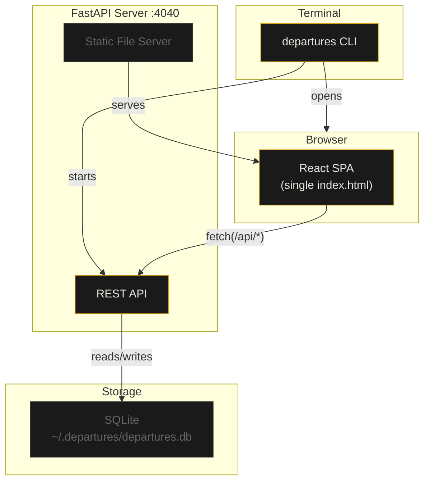
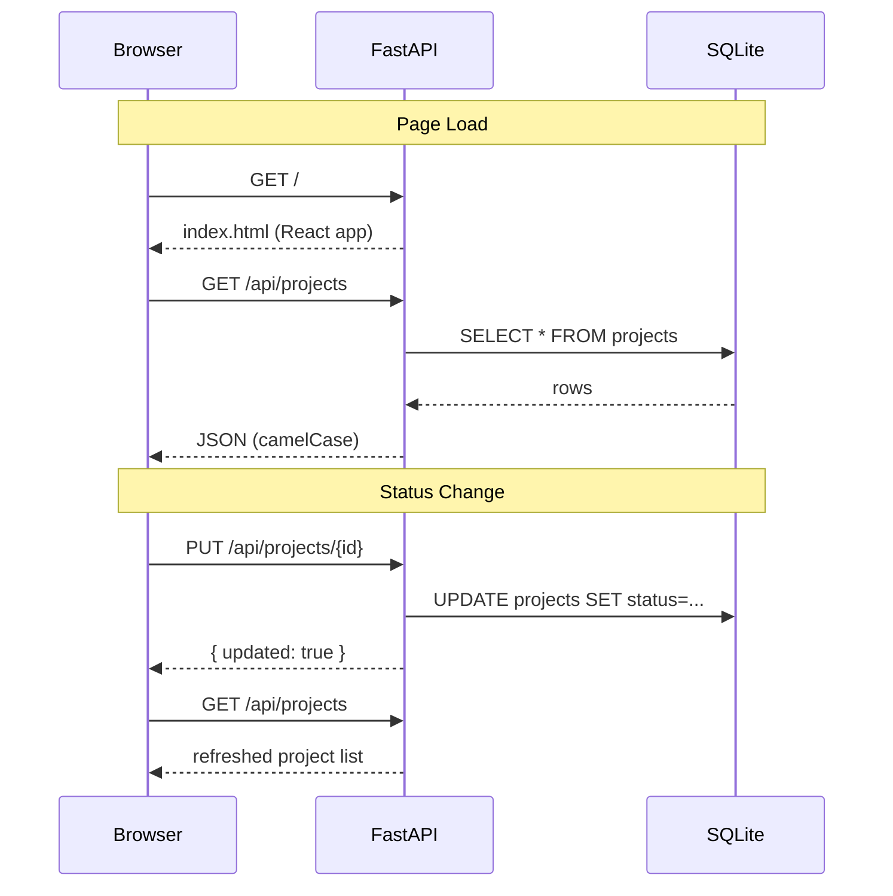
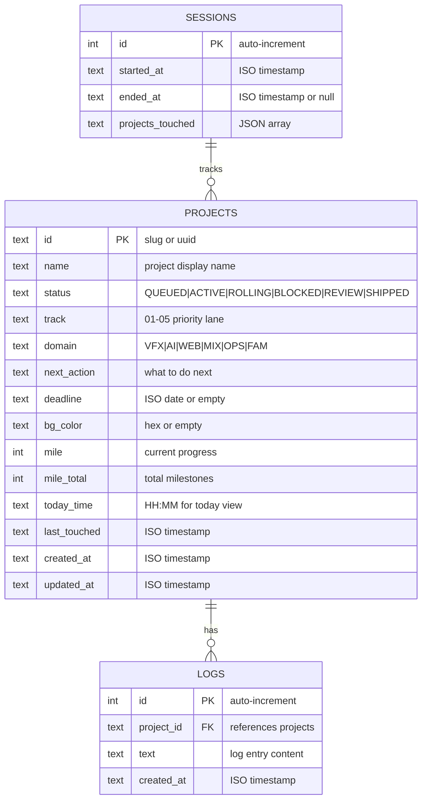
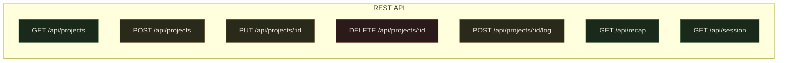
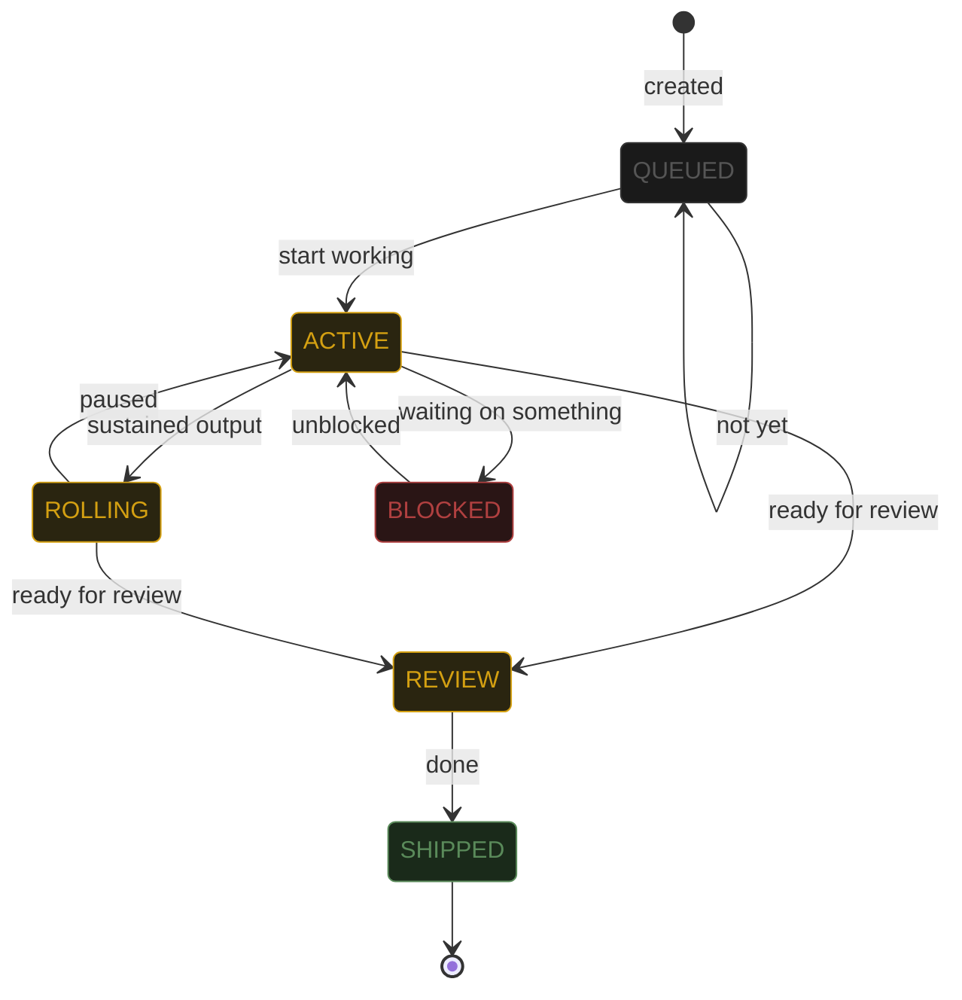

# DEPARTURES

**A project board that feels like a train station, not a spreadsheet.**

Split-flap characters. Amber on black. One command and you're looking at your work — not configuring a tool.

Built for brains that need momentum, not management.


---

## 30-Second Install

You need **Python 3.10 or newer**. That's the only prerequisite.

> **Don't have Python?**
> Download it from [python.org/downloads](https://www.python.org/downloads/).
> During install on Windows, **check the box that says "Add Python to PATH"** — this is the one thing people miss.
> On Mac, `brew install python` if you have Homebrew, or grab the installer from the link above.

### Step 1: Get the code

```bash
git clone https://github.com/JosephOIbrahim/Slit-Flap.git
cd Slit-Flap/departures-v0.4/departures
```

### Step 2: Install

```bash
pip install -e .
```

### Step 3: Run

```bash
departures
```

Your browser opens to `http://localhost:4040`. You're done.

> **If something went wrong**, jump to [Troubleshooting](#troubleshooting) below. It's probably one of three things and all of them are fixable in under a minute.

---

## What You're Looking At

```
╔══════════════════════════════════════════════════════════╗
║                                                          ║
║   ┌─┐┌─┐┌─┐┌─┐┌─┐┌─┐┌─┐┌─┐┌─┐┌─┐┌─┐                  ║
║   │D││E││P││A││R││T││U││R││E││S││ │                  ║
║   └─┘└─┘└─┘└─┘└─┘└─┘└─┘└─┘└─┘└─┘└─┘                  ║
║                                                          ║
║   SOLARI PROTOCOL v0.4.0                                 ║
║                                                          ║
╚══════════════════════════════════════════════════════════╝
```

Each project is a row on a departure board. Each letter in the project name is its own split-flap module — a physical tile with a slit through the middle, like the ones at Grand Central or Schiphol. When a status changes, the characters flip.

### The Board

| Element | What it does |
|---|---|
| **Split-flap title** | Giant project name in Disket Mono. The thing you can't miss. |
| **Status badge** | Click to cycle: `QUEUED` > `ACTIVE` > `ROLLING` > `BLOCKED` > `REVIEW` > `SHIPPED` |
| **NEXT UP** | The board picks your highest-priority project so you don't have to decide |
| **Track** | Priority lane (`01` = urgent, `05` = backburner) |
| **Domain** | `VFX` / `AI` / `WEB` / `MIX` / `OPS` / `FAM` |
| **Mile marker** | Progress: mile 3 of 8. Marathon-style — see the finish line. |
| **Session pulse** | Ambient dot + timer. Green < 2h, amber < 4h, red > 4h. |
| **TODAY view** | Timeline with projects, calendar events, and emails interleaved |
| **Daily Recap** | End-of-day summary: projects touched, session time, log count |
| **+ / - controls** | Scale the split-flap character size up or down |
| **L / C / R** | Align project titles left, center, or right |

### Design Rules

Two fonts. One color. Negative space is structure.

- **Disket Mono** — display font for project names (104px default)
- **JetBrains Mono** — system font for everything else (7-10px)
- **Amber `#d4a012`** — the only accent color. Blocked gets `#b04040`.
- **No icons, no gradients, no decoration** — hierarchy comes from scale alone

---

## How It Works

### Architecture



### Request Flow



### Data Model



### Project Structure

```
Slit-Flap/
└── departures-v0.4/
    └── departures/
        ├── pyproject.toml          # package config + dependencies
        ├── CLAUDE.md               # AI collaboration context
        ├── README.md               # you are here
        └── departures/
            ├── __init__.py
            ├── __main__.py         # python -m departures
            ├── cli.py              # CLI: banner, args, browser launch
            ├── server.py           # FastAPI: API routes + static serving
            ├── db.py               # SQLite: schema, CRUD, seed data
            └── frontend/
                └── dist/
                    └── index.html  # compiled React app (single file)
```

---

## API Reference

All endpoints return JSON. The server runs on `localhost:4040` by default.



| Method | Endpoint | Body | Returns |
|---|---|---|---|
| `GET` | `/api/projects` | — | All projects sorted by track + status |
| `POST` | `/api/projects` | `{ name, status, track, domain, ... }` | `{ id }` |
| `PUT` | `/api/projects/:id` | Partial update (any field) | `{ id, updated: true }` |
| `DELETE` | `/api/projects/:id` | — | `{ id, deleted: true }` |
| `POST` | `/api/projects/:id/log` | `{ text }` | `{ project_id, text, at }` |
| `GET` | `/api/recap` | — | Today's summary |
| `GET` | `/api/session` | — | `{ startedAt, elapsedMinutes, elapsedSeconds }` |

### Quick Test

```bash
# List projects
curl http://localhost:4040/api/projects | python -m json.tool

# Create a project
curl -X POST http://localhost:4040/api/projects \
  -H "Content-Type: application/json" \
  -d '{"name": "My New Project", "domain": "AI", "track": "02"}'

# Add a log entry
curl -X POST http://localhost:4040/api/projects/otto/log \
  -H "Content-Type: application/json" \
  -d '{"text": "Started the integration work"}'
```

---

## CLI Options

```bash
departures                      # default: localhost:4040, opens browser
departures --port 8080          # custom port
departures --no-browser         # start server only, no browser
departures --host 0.0.0.0      # expose to your local network
```

You can also run it as a Python module:

```bash
python -m departures
python -m departures --port 8080
```

---

## Status Lifecycle



Click the status label on any project card to cycle through states. The split-flap characters flip on each transition.

---

## NEXT UP Algorithm

The board automatically highlights one project as **NEXT UP** so you don't waste energy deciding what to work on. The scoring:

| Factor | Points | Why |
|---|---|---|
| Has a time block today | +100 | You already committed to it |
| Status is ACTIVE | +50 | It's in progress |
| Status is ROLLING | +40 | You have momentum |
| Track 01 (urgent) | +30 | Priority lane |
| Track 02 | +20 | Important |
| Track 03 | +10 | Normal |
| Days since last touched | +3/day (max 40) | Staleness penalty |

Highest score wins. Ties go to the first match. `SHIPPED` and `QUEUED` projects are excluded.

---

## Where Your Data Lives

```
~/.departures/
└── departures.db          # SQLite database (auto-created on first run)
```

- The database is created automatically on first launch
- Seed projects are inserted if the database is empty
- Your data stays on your machine — nothing is sent anywhere
- Back it up by copying `~/.departures/departures.db`
- Reset everything by deleting that file — a fresh board will be seeded on next launch

---

## Troubleshooting

**"command not found: departures"**
> Python scripts aren't on your PATH. Try `python -m departures` instead, or re-run `pip install -e .` and check if pip warns about the scripts directory.

**Unicode error / garbled banner on Windows**
> Fixed in v0.4.0. If you see it, make sure you have the latest code (`git pull`). The CLI forces UTF-8 output on Windows.

**"Port 4040 already in use"**
> Another instance is running. Either close it or use a different port: `departures --port 8080`

**"No module named departures"**
> You need to install first: `cd` into the directory with `pyproject.toml` and run `pip install -e .`

**Browser didn't open**
> The server is still running — just open `http://localhost:4040` manually. Or check your default browser settings.

**Want to start fresh?**
> Delete `~/.departures/departures.db` and restart. A clean board with seed projects will be created.

---

## Tech Stack

| Layer | Technology | Why |
|---|---|---|
| **CLI** | argparse + uvicorn | Zero dependencies beyond the server |
| **Server** | FastAPI | Async, fast, auto-docs at `/docs` |
| **Database** | SQLite via aiosqlite | Zero config, file-based, portable |
| **Frontend** | React 18 (CDN) | Single HTML file, no build step needed |
| **Fonts** | Disket Mono + JetBrains Mono | Display + system. Two fonts, no more. |

---

## For Artists & Non-Coders

You don't need to understand any of this to use it. Here's what matters:

1. **Install Python** if you don't have it
2. **Run three commands** (clone, install, launch)
3. **Open your browser** — it happens automatically
4. **Click things** — statuses cycle, panels expand, logs capture notes

The board is yours. Add projects, track progress, log what you did. Close the terminal when you're done. Your data is saved locally and will be there next time.

If you use **Houdini, Nuke, or any DCC** — you already have Python. You're already set.

---

## License

MIT

---

<sub>DEPARTURES 0.4 -- SOLARI PROTOCOL -- USD-COMPOSED PROJECT STATE</sub>
