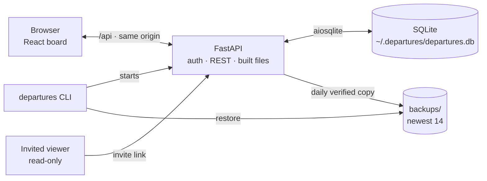
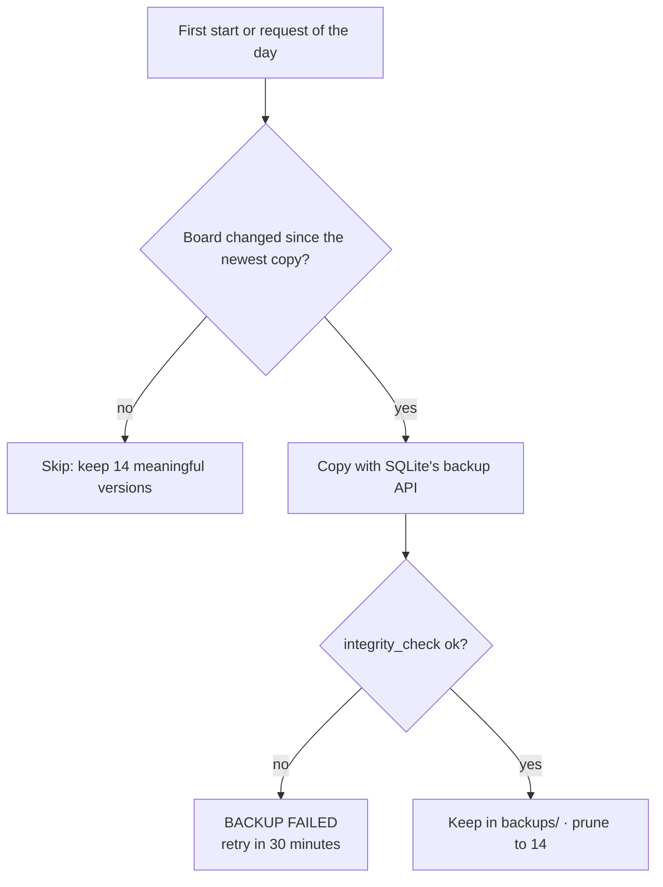
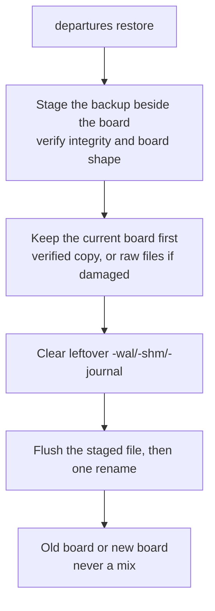
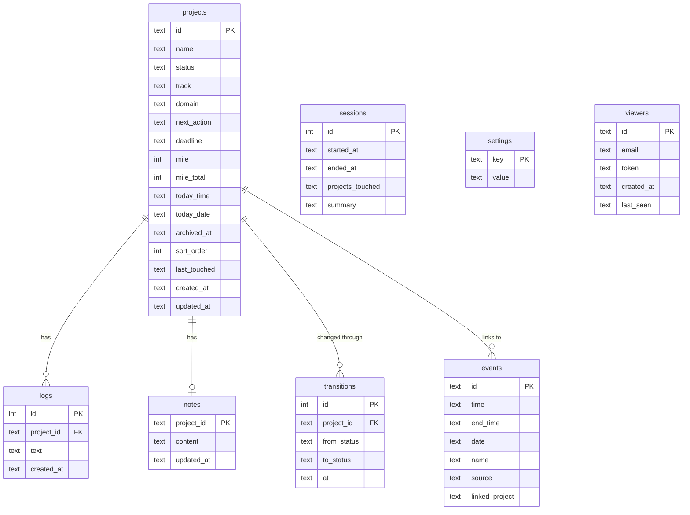

# Architecture

*How DEPARTURES is put together, and why. The README is the operator's view; this is the builder's.*

## The shape



Three boundaries, each with one job:

1. **The browser** holds the board's view state. It never touches the database or the filesystem.
2. **The FastAPI process** is the only writer. It authenticates every request, owns the REST API, and serves the built frontend by exact file name.
3. **SQLite plus the backups folder** is the only durable state. One file is the board; the copies are the recovery path.

The default bind is `127.0.0.1`. That is the security boundary: without `--host 0.0.0.0`, no other device can reach the API. In share mode the same process admits invited viewers read-only through `/join/<token>` and refuses every write from them.

Writes also require an `X-Departures` header. A page on another site can make the owner's browser send a simple POST without reading the answer, but it cannot add a custom header without a browser preflight, and the board grants no cross-origin access. The board's own page sends the header on every write.

## When things change

A daily backup is taken on the first start or admitted request of the day, but only when the board's content differs from the newest copy. Sessions, a viewer's last-seen time and SQLite's counters are bookkeeping, not content, so they do not force a copy.



A restore is two phases, so the board is never half-replaced:



The one rename is the commit point. A Ctrl+C, a crash or a power cut before it leaves the old board; after it leaves the restored one. The kept copy is what undo means.

## Data model



Notes:

- `archived_at` is the delete. An archived project, its notes and its logs stay in the file; the board hides it and the ARCHIVED filter shows it.
- `today_time` and `today_date` travel together. A block only counts on its day.
- `events.date` makes an event a one-day event; `linked_project` is a project id chosen from the picker.
- `transitions` records every status change server-side, so the "N transitions" count is evidence of progress rather than a number the browser resets on reload.
- `sessions` records work sessions, not server uptime. It is written on the first owner request after a 45-minute gap.

## Migrations

The schema version lives in `PRAGMA user_version`. `_MIGRATIONS` is an ordered list of `(version, name, step)`; each step runs once, in its own transaction, and the version moves in that same transaction. A step that fails rolls back and is retried on the next start. Never edit a shipped step; append the next number.

Steps so far:

| Version | Step |
|---------|------|
| 1 | `projects.sort_order`: add it, or renumber duplicates |
| 2 | `projects.today_date`: add it; date existing blocks today |
| 3 | `events.date`: add it; date existing events today |
| 4 | `projects.archived_at`: add it |
| 5 | `transitions`: create the status-history table |

An earlier 0.5.x board upgrades in place on first start, after that day's backup.

## Design rules

Studio restraint, applied literally:

- **Two voices.** Project names in the split-flap display face; everything else in a 9px system face. No middle volume.
- **One accent.** Amber `#d4a012` means "this needs you". It is not decoration.
- **Whitespace is structure.** Panels sit in 18px gutters; the grid snaps to 4/8/12/18/24/36/48px.
- **Motion is punctuation.** A card flips when something changed; nothing else moves.
- **The answer first.** Headings state the point; paragraphs hold one idea; a scanning reader can stop anywhere and still know where they are.

Fonts: Disket Mono for identity (licensed CDN; its EULA permits web use but not redistribution, so it is not bundled) and JetBrains Mono for everything else (bundled woff2, OFL, works offline). Six greys: `#999`, `#666`, `#444`, `#2a2a2a`, `#1a1a1a`, `#111`.

## Tests and build

```bash
python -m pytest -q        # backend and data safety
cd frontend && npm test    # pure browser-side logic (time, scoring, notes, keepalive)
cd frontend && npm run build
```

The suite passes whether or not the board is running: the running-board probe is stubbed in tests, and every test gets a temporary data folder.

The frontend build writes straight into `departures/frontend/dist/`, which is gitignored and bundled into the wheel. The server lists that folder itself and serves only exact names; no request path touches the filesystem.
